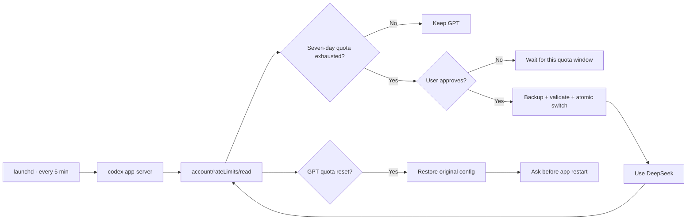

# Codex Quota Guardian

> Keep coding when Codex hits its weekly limit — without losing your way back to GPT.

[](#requirements)
[](#requirements)
[](#how-it-works)

English · [简体中文](README.zh-CN.md)

**Codex Quota Guardian** is a safety-first macOS failover utility for Codex in the ChatGPT desktop app and Codex CLI. It watches the seven-day Codex quota, asks before switching to DeepSeek, and restores your original GPT configuration when the quota resets.

No silent provider changes. No plaintext API keys. No force-killing an active app.

> [!NOTE]
> This is an independent community project. It is not affiliated with OpenAI or DeepSeek.

## Why this exists

Running out of weekly Codex quota usually happens in the middle of real work. Switching providers by hand is easy; remembering every config change and safely switching back later is the fragile part.

Codex Quota Guardian turns that recovery path into a small, reversible state machine:

- polls the official Codex App Server rate-limit endpoint every five minutes;
- recognizes only the explicit seven-day window (`10080` minutes);
- asks before switching to DeepSeek;
- backs up and validates the new config before replacing anything;
- keeps checking GPT availability while DeepSeek is active;
- restores the exact original config after the weekly window resets;
- asks before restarting the ChatGPT app and never force-terminates it.

The poller sends only `initialize` and `account/rateLimits/read`. It does **not** start a thread, start a turn, or make a model inference request, so polling does not consume model tokens. See the official [Codex App Server documentation](https://learn.chatgpt.com/docs/app-server#6-rate-limits-chatgpt).

## What makes it safe

| Situation | Guardian behavior |
| --- | --- |
| Weekly quota is available | Keeps GPT untouched |
| Five-hour window is exhausted | Does not switch |
| Quota response is missing or unknown | Fails closed; does not change providers |
| You decline the switch | Remembers the decision for that reset window |
| You accept the switch | Backs up, validates, atomically writes, then restarts politely |
| You edit `config.toml` after the switch | Refuses to overwrite your changes and creates a proposed restore file |
| GPT quota resets | Restores the original config automatically |
| The app does not quit normally | Stops instead of force-killing it |
| DeepSeek credentials are needed | Reads them from macOS Keychain through `auth.command` |

## Quick start

### Requirements

- macOS
- ChatGPT desktop app or Codex CLI installed and signed in
- Python 3.9 or newer
- a DeepSeek API key
- a Codex build that supports custom-provider `auth.command`

The generated configuration has been validated with `codex-cli 0.162.0-alpha.17.2`. Run the test suite and a dry run when using a materially different Codex version.

### Install

```bash
git clone https://github.com/Hazenix/codex-quota-guardian.git
cd codex-quota-guardian

# Preview every path the installer will write.
PYTHONPATH=src /usr/bin/python3 -m codex_quota_guardian install --dry-run

# Install the runtime, CLI wrappers, and five-minute LaunchAgent.
PYTHONPATH=src /usr/bin/python3 -m codex_quota_guardian install

# Enter the key in the secure macOS terminal prompt.
~/.local/bin/codex-quota-guardian setup-key
```

Do not paste API keys into chat, shell history, issues, or configuration files. `setup-key` lets `/usr/bin/security` read the value interactively and stores it in macOS Keychain. The key never becomes a command-line argument.

The default fallback model is `deepseek-flash`. To use `deepseek-v4-pro`:

```bash
PYTHONPATH=src /usr/bin/python3 -m codex_quota_guardian install \
  --model deepseek-v4-pro
```

DeepSeek's official Codex integration and supported model names are documented in the [DeepSeek API docs](https://api-docs.deepseek.com/quick_start/agent_integrations/codex/).

## How it works



This is a standalone background utility, not a Codex Skill or a model-driven automation. A Skill would need a working model turn precisely when the quota is unavailable; `launchd` and `codex app-server` give the failover controller an independent execution path.

### Configuration strategy

The ChatGPT desktop app and Codex CLI use the same `~/.codex/config.toml`. When switching, the guardian:

1. records whether the original file existed;
2. creates a private backup;
3. preserves unrelated TOML sections and multiline strings;
4. adds a managed DeepSeek custom provider using `wire_api = "responses"`;
5. reads the token from Keychain through a small `auth.command` helper;
6. asks the installed Codex binary to strictly load an isolated copy of the generated config;
7. replaces the active config atomically only after validation succeeds.

It deliberately preserves the existing ChatGPT authentication mode. That allows the background checker to keep reading the GPT weekly quota while DeepSeek is active.

## Usage

Check the current provider and weekly quota:

```bash
~/.local/bin/codex-quota-guardian status
```

Run an immediate interactive check:

```bash
~/.local/bin/codex-quota-guardian check
```

Use the opt-in CLI wrapper. It checks quota first and then delegates every argument and exit code to the real Codex binary:

```bash
~/.local/bin/codex-auto
~/.local/bin/codex-auto exec "inspect the current project"
```

The original `codex` command is never replaced or shadowed.

Manual recovery commands:

```bash
~/.local/bin/codex-quota-guardian switch-deepseek
~/.local/bin/codex-quota-guardian restore-gpt
~/.local/bin/codex-quota-guardian restart-app
```

## Files and permissions

| Purpose | Path |
| --- | --- |
| State | `~/Library/Application Support/CodexQuotaGuardian/state.json` |
| Config backups | `~/Library/Application Support/CodexQuotaGuardian/backups/` |
| Installed runtime | `~/Library/Application Support/CodexQuotaGuardian/runtime/` |
| LaunchAgent | `~/Library/LaunchAgents/com.hazehacker.codex-quota-guardian.plist` |
| Log | `~/Library/Logs/codex-quota-guardian.log` |
| Commands | `~/.local/bin/codex-quota-guardian`, `codex-auto` |
| API credential | macOS login Keychain |

Private state, manifests, model catalogs, and backups are written with user-only permissions where applicable. Stable background checks stay quiet; actionable failures are surfaced through macOS notifications or the CLI.

## Uninstall

```bash
~/.local/bin/codex-quota-guardian uninstall
```

Uninstall restores GPT first, unloads the LaunchAgent, and removes the installed runtime and wrappers. State and backups are kept by default for recovery. Delete those too only when you are certain they are no longer needed:

```bash
~/.local/bin/codex-quota-guardian uninstall --purge
```

## Development

The project uses the Python standard library only.

```bash
python3 -m unittest discover -s tests -t . -v
PYTHONPYCACHEPREFIX=/tmp/codex-quota-guardian-pyc \
  python3 -m compileall -q src tests
```

The suite covers rate-limit parsing, config preservation and conflict detection, Keychain command construction, process locking, notifications, install/uninstall behavior, and the full failover state machine. Tests never call a model or incur DeepSeek API charges.

Contributions are welcome, especially around:

- additional fallback providers without weakening the safety model;
- Linux scheduling and secret-store support;
- compatibility reports for stable Codex releases;
- clearer diagnostics and recovery UX;
- reproducible end-to-end tests with synthetic quota responses.

Please include the relevant test and describe the failure mode your change handles.

## Current limitations

- macOS only.
- Switching changes the provider for new work; it does not guarantee seamless continuation of an in-flight conversation.
- Only an explicit seven-day Codex window triggers automatic failover.
- Ordinary HTTP `429` responses and shorter quota windows do not trigger a switch.
- ChatGPT Work cloud tasks and remote Codex cloud tasks are outside the current scope.
- The test suite validates integration behavior without making a paid DeepSeek model request.

## Project status

This is an early release built around a real personal failover workflow. The implementation is intentionally conservative: when state, quota, credentials, or config ownership is ambiguous, it does nothing and asks for human intervention.

If this saves your coding session, consider starring the repository. Bug reports with sanitized logs and reproducible steps are even more valuable.
