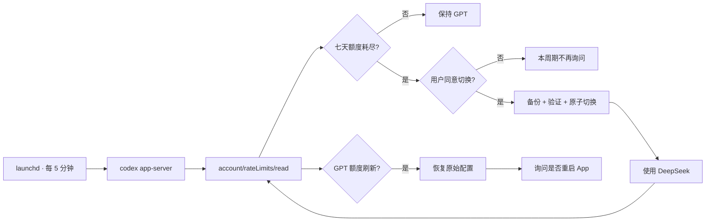

# Codex Quota Guardian

> Codex 周额度用完后继续工作，并在额度恢复时安全切回 GPT。

[](#运行要求)
[](#运行要求)
[](#工作原理)

[English](README.md) · 简体中文

**Codex Quota Guardian** 是一个安全优先的 macOS Codex 降级工具，同时支持 ChatGPT 桌面 App 中的 Codex 和 Codex CLI。它会监控七天额度，在额度耗尽时询问是否切换到 DeepSeek，并在额度刷新后恢复原来的 GPT 配置。

不会静默切换 provider，不会明文保存 API Key，也不会强制结束正在运行的 App。

> [!NOTE]
> 这是一个独立的社区项目，与 OpenAI、DeepSeek 均无隶属关系。

## 为什么需要它

Codex 周额度往往在真正工作到一半时耗尽。手动换 provider 并不难，容易出问题的是记住所有配置改动，并在额度恢复后完整、安全地切回来。

Codex Quota Guardian 把这个过程变成一个保守、可恢复的状态机：

- 每五分钟通过官方 Codex App Server 读取一次额度；
- 只识别明确的七天窗口（`10080` 分钟）；
- 切换 DeepSeek 前先征求用户同意；
- 替换任何配置前先备份并严格验证；
- DeepSeek 生效期间继续检查 GPT 是否恢复；
- 周额度刷新后精确恢复原始配置；
- 重启 ChatGPT App 前先确认，无法正常退出时绝不强制结束进程。

轮询只发送 `initialize` 和 `account/rateLimits/read`，不会调用 `thread/start`、`turn/start` 或模型推理，因此不消耗模型 token。参见官方 [Codex App Server 文档](https://learn.chatgpt.com/docs/app-server#6-rate-limits-chatgpt)。

## 安全边界

| 场景 | 工具行为 |
| --- | --- |
| 周额度可用 | 保持 GPT 配置不变 |
| 五小时窗口耗尽 | 不切换 |
| 额度字段缺失或状态未知 | 失败关闭，不改 provider |
| 用户拒绝切换 | 当前重置周期内不再重复询问 |
| 用户同意切换 | 备份、验证、原子写入，然后礼貌重启 |
| 切换后用户修改了 `config.toml` | 不覆盖用户改动，生成建议恢复文件 |
| GPT 周额度刷新 | 自动恢复原配置 |
| App 无法正常退出 | 停止操作，不使用强制结束 |
| DeepSeek 需要凭据 | 通过 `auth.command` 从 macOS Keychain 读取 |

## 快速开始

### 运行要求

- macOS
- 已安装并登录 ChatGPT 桌面 App 或 Codex CLI
- Python 3.9 或更高版本
- DeepSeek API Key
- 支持 custom provider `auth.command` 的 Codex 版本

生成配置已在 `codex-cli 0.162.0-alpha.17.2` 上通过验证。如果 Codex 版本差异较大，建议先运行完整测试和 dry run。

### 安装

```bash
git clone https://github.com/Hazehacker/codex-quota-guardian.git
cd codex-quota-guardian

# 预览安装器会写入的全部路径。
PYTHONPATH=src /usr/bin/python3 -m codex_quota_guardian install --dry-run

# 安装运行时、CLI wrapper 和每五分钟运行一次的 LaunchAgent。
PYTHONPATH=src /usr/bin/python3 -m codex_quota_guardian install

# 在 macOS 安全终端提示中输入 Key。
~/.local/bin/codex-quota-guardian setup-key
```

不要把 API Key 粘贴到聊天、shell 历史、Issue 或配置文件中。`setup-key` 让 `/usr/bin/security` 在终端内交互读取，并将凭据保存到 macOS Keychain；Key 不会成为命令行参数。

默认使用 `deepseek-flash`。如需 `deepseek-v4-pro`：

```bash
PYTHONPATH=src /usr/bin/python3 -m codex_quota_guardian install \
  --model deepseek-v4-pro
```

DeepSeek 的 Codex 接入方式和支持的模型名称见 [DeepSeek API 文档](https://api-docs.deepseek.com/quick_start/agent_integrations/codex/)。

## 工作原理



它是独立运行的后台工具，不是 Codex Skill，也不是由模型驱动的自动化。Skill 恰好需要在额度不可用时发起模型 turn；`launchd` 和 `codex app-server` 则为故障切换控制器提供了独立执行路径。

### 配置策略

ChatGPT 桌面 App 和 Codex CLI 共用 `~/.codex/config.toml`。切换时，守护器会：

1. 记录原始配置文件是否存在；
2. 创建仅当前用户可读的备份；
3. 保留无关 TOML section 和多行字符串；
4. 添加使用 `wire_api = "responses"` 的受管 DeepSeek provider；
5. 通过 `auth.command` 从 Keychain 读取 token；
6. 让已安装的 Codex 二进制严格加载隔离后的生成配置；
7. 只有验证通过后才原子替换活动配置。

工具会保留原有 ChatGPT 登录方式。这样即使 DeepSeek 已生效，后台检查仍能读取 GPT 周额度并判断何时恢复。

## 使用方法

查看当前 provider 和周额度：

```bash
~/.local/bin/codex-quota-guardian status
```

立即进行一次交互式检查：

```bash
~/.local/bin/codex-quota-guardian check
```

按需使用 CLI wrapper。它会先检查额度，再把全部参数和退出过程交给真实的 Codex 二进制：

```bash
~/.local/bin/codex-auto
~/.local/bin/codex-auto exec "检查当前项目"
```

工具不会替换或遮蔽原来的 `codex` 命令。

手动恢复命令：

```bash
~/.local/bin/codex-quota-guardian switch-deepseek
~/.local/bin/codex-quota-guardian restore-gpt
~/.local/bin/codex-quota-guardian restart-app
```

## 文件与权限

| 用途 | 路径 |
| --- | --- |
| 状态 | `~/Library/Application Support/CodexQuotaGuardian/state.json` |
| 配置备份 | `~/Library/Application Support/CodexQuotaGuardian/backups/` |
| 安装后的运行时 | `~/Library/Application Support/CodexQuotaGuardian/runtime/` |
| LaunchAgent | `~/Library/LaunchAgents/com.hazehacker.codex-quota-guardian.plist` |
| 日志 | `~/Library/Logs/codex-quota-guardian.log` |
| 命令 | `~/.local/bin/codex-quota-guardian`、`codex-auto` |
| API 凭据 | macOS 登录 Keychain |

状态、安装清单、模型目录和备份等私有文件会在适用时使用仅当前用户可读的权限。稳定的后台检查不会制造日志噪声；需要处理的失败会通过 macOS 通知或 CLI 显示。

## 卸载

```bash
~/.local/bin/codex-quota-guardian uninstall
```

卸载会先恢复 GPT，然后卸载 LaunchAgent，并删除安装后的运行时和 wrapper。状态与配置备份默认保留，便于恢复；只有确认不再需要后才使用：

```bash
~/.local/bin/codex-quota-guardian uninstall --purge
```

## 开发与贡献

项目只使用 Python 标准库。

```bash
python3 -m unittest discover -s tests -t . -v
PYTHONPYCACHEPREFIX=/tmp/codex-quota-guardian-pyc \
  python3 -m compileall -q src tests
```

测试覆盖额度解析、配置保留与冲突检测、Keychain 命令构造、进程锁、通知、安装/卸载以及完整故障切换状态机。测试不会请求模型，也不会产生 DeepSeek API 费用。

欢迎贡献，尤其是：

- 在不削弱安全模型的前提下支持更多 fallback provider；
- Linux 调度器与凭据存储；
- Codex 稳定版本兼容性报告；
- 更清晰的诊断和恢复体验；
- 基于合成额度响应的可重复端到端测试。

提交 PR 时，请补充相关测试，并说明改动解决的具体失败场景。

## 当前限制

- 仅支持 macOS。
- 切换影响后续工作，不保证正在进行的同一条对话可以在 GPT 与 DeepSeek 之间无缝续接。
- 只有明确的七天 Codex 窗口才会触发自动降级。
- 普通 HTTP `429` 和更短的额度窗口不会触发切换。
- ChatGPT Work Cloud 与远程 Codex 云任务不在当前范围内。
- 测试验证集成行为，但不会发起付费 DeepSeek 模型请求。

## 项目状态

这是一个源于真实个人工作流的早期版本。实现有意保持保守：只要状态、额度、凭据或配置所有权存在歧义，它就不会擅自修改，而是等待人工处理。

如果它帮你避免了一次编码中断，欢迎点一个 Star。带有脱敏日志和稳定复现步骤的 Bug Report 会更有价值。
